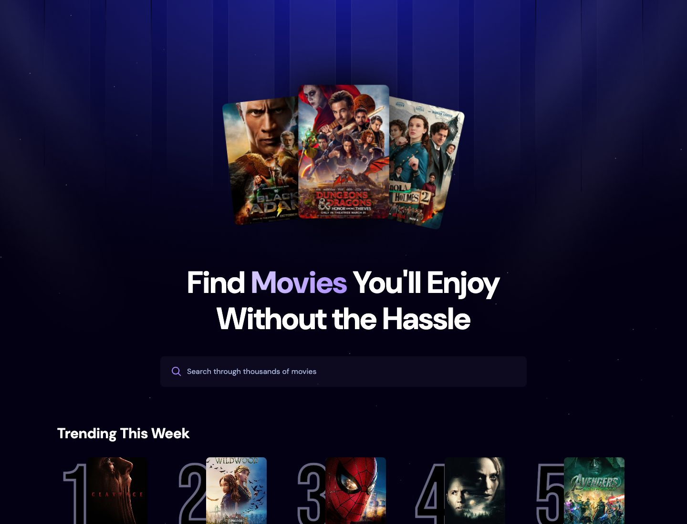
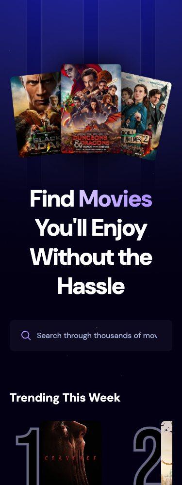

# Popular Movies

[](https://github.com/JustineVizco25/popular-movies-website/actions/workflows/ci.yml)

A responsive React app for finding a movie to watch. Browse popular titles, explore ten weekly trends, and search TMDB's catalog with results that load as you scroll.

Built as a frontend learning and portfolio project with **React 19, JavaScript, Tailwind CSS 4, Vite, and TMDB**, plus optional **Appwrite** search analytics.

[Recruiter walkthrough](#recruiter-walkthrough) · [Run locally](#run-locally) · [Code tour](#code-tour) · [Testing](#testing) · [Credits](#credits)



<details>
<summary>View the mobile interface</summary>



</details>

## Recruiter walkthrough

After starting the app locally, this short tour highlights the main frontend work:

1. **Browse the landing page.** The trending strip scrolls horizontally, while the movie grid adapts from one to four columns.
2. **Search for a title.** Typing pauses for 500 ms before a request is sent. Cards present a poster, rating, original language, and release year.
3. **Change your search quickly.** Previous requests are cancelled, and a request ID guard prevents stale responses from replacing newer results.
4. **Scroll through results.** An `IntersectionObserver` requests the next page near the bottom. Duplicate IDs are merged, and a **Load more movies** button supports keyboard navigation.
5. **Try an unlikely title, then clear the search.** The empty state gives feedback; blank input resets to popular movies.
6. **Review failure handling.** Failed requests offer a retry. A failed next page preserves loaded cards, and missing or broken posters use a local fallback.

For a code-first review, start with [App.jsx](src/App.jsx) and the [browser regression suite](tests/movies.spec.js).

### Skills demonstrated

| Skill | Evidence in the project |
| --- | --- |
| React state and effects | Search, loading, error, pagination, and retry state |
| REST APIs | Encoded queries, bearer authentication, HTTP error handling, and cancellation |
| Async UI behavior | Debouncing, stale-response protection, pagination locks, and same-page retries |
| Reusable components | Separate search, card, poster, and loading components |
| Responsive CSS | Tailwind breakpoints, fluid grids, and horizontal scrolling |
| Accessibility | Labeled input, status/alert roles, visible focus, and keyboard pagination |
| Reliability | Playwright tests, ESLint, production builds, and GitHub Actions |
| Service integration | Optional Appwrite metrics with atomic increments and non-blocking failures |

## Features

- Popular movies sorted by popularity and ten weekly trending titles.
- Debounced search with whitespace normalization and query encoding.
- Infinite scrolling, manual loading, duplicate removal, and a 500-page cap.
- Loading, empty, error, and retry states for the movie grid.
- Lazy-loaded posters with fallbacks for missing and failed images.
- Optional Appwrite search counts; browsing works without Appwrite.

**Trending This Week comes from TMDB**, independently of the optional search counts stored in Appwrite.

## Run locally

### Prerequisites

- Node.js **24** is used locally and in CI; the project requires **22.12 or newer**.
- npm and a [TMDB account](https://www.themoviedb.org/).
- A TMDB **API Read Access Token** from your account's API settings. Use the read access token rather than the v3 API key: this app authenticates with a bearer header. See [TMDB's authentication guide](https://developer.themoviedb.org/docs/authentication-application).

### Installation

```bash
git clone https://github.com/JustineVizco25/popular-movies-website.git
cd popular-movies-website
nvm use  # Optional, if you use nvm
npm ci
cp src/.env.example src/.env
```

Set the required value in `src/.env`:

```dotenv
VITE_TMDB_API_KEY=your_tmdb_api_read_access_token
```

Leave the Appwrite values blank unless you want analytics, then start the app:

```bash
npm run dev
```

Open the URL printed by Vite. Restart the server after changing environment variables.

> `vite.config.js` sets `envDir: 'src'`, so the environment file belongs in **`src/.env`**. A missing TMDB token shows setup guidance instead of a blank page.

### Environment variables

| Variable | Required | Purpose |
| --- | --- | --- |
| `VITE_TMDB_API_KEY` | Yes | TMDB API Read Access Token |
| `VITE_APPWRITE_ENDPOINT` | No | Appwrite endpoint, including `/v1` |
| `VITE_APPWRITE_PROJECT_ID` | No | Appwrite project ID |
| `VITE_APPWRITE_DATABASE_ID` | No | Database containing the analytics table |
| `VITE_APPWRITE_TABLE_ID` | No | Table storing search counts |

Local `.env` files and build output are excluded from Git. Vite embeds `VITE_*` values into browser code, so these are **not server-side secrets**. Never put an Appwrite server API key in this frontend. Keeping a deployed TMDB token private requires a backend proxy.

## Optional Appwrite setup

Movie discovery only needs TMDB. For analytics, provide all four Appwrite values and configure a dedicated demo table using **TablesDB**:

1. Create an Appwrite project and add a Web platform for `localhost`. Add your deployment hostname if you later host the app.
2. Create a database and table with the following required columns.
3. Create a **unique index on `searchTerm`** to prevent duplicate rows when visitors search together.
4. For this unauthenticated demo, give the dedicated table `read`, `create`, and `update` permissions for `Any`. Use a table without private information. See [Appwrite's permissions guide](https://appwrite.io/docs/products/databases/tablesdb/permissions).
5. Copy the endpoint and IDs into `src/.env`, then restart Vite.

| Column | Type | Suggested size / value |
| --- | --- | --- |
| `searchTerm` | String | 512 characters |
| `count` | Integer | At least 0; new rows start at 1 |
| `movie_id` | Integer | TMDB ID of the first result |
| `poster_url` | String | 2048 characters |

A successful first page of a non-empty search records the trimmed query and its first movie result. Loading more pages does not increment the count. Existing rows use atomic increments; simultaneous inserts that conflict with the unique index are retried as increments. Analytics failures do not interrupt browsing.

These are shared demo metrics. Client-written counts can be changed by callers with table permissions; authoritative analytics would need a server endpoint with validation and rate limiting.

## Code tour

```text
src/
├── App.jsx                    # TMDB requests, search, pagination, retry, and layout
├── appwrite.js                # Optional search tracking through TablesDB
├── components/
│   ├── Search.jsx             # Controlled, labeled search input
│   ├── MovieCard.jsx          # Title, rating, language, and year
│   ├── MoviePoster.jsx        # Lazy loading and image fallback
│   └── Spinner.jsx            # Accessible loading status
├── index.css                  # Tailwind theme and responsive styles
├── main.jsx                   # React root with StrictMode
└── .env.example               # Configuration template without credentials
tests/movies.spec.js           # Browser tests with mocked TMDB responses
playwright.config.js           # Isolated test server with analytics disabled
.github/workflows/ci.yml       # Install, lint, browser tests, and build
docs/                         # Desktop and mobile screenshots
```

### How data moves through the app

The input updates immediately. After 500 ms, a trimmed query resets pagination and triggers `/search/movie` or `/discover/movie`. Effect cleanup aborts the previous request, and a request ID guards against stale responses.

Page one replaces the list; later pages merge by movie ID. An observer watches a sentinel near the bottom, while a lock prevents overlapping page increments. Failed pagination retries the same page. Weekly trends are fetched separately through `/trending/movie/week`, so a trending failure does not block the catalog.

## Testing

```bash
npm run lint
npx playwright install chromium  # One-time browser installation
npm test
npm run build
npm run preview                 # Optional: inspect the production build
```

With Chrome already installed, macOS/Linux users can also run:

```bash
PLAYWRIGHT_CHROMIUM_CHANNEL=chrome npm test
```

The ten Playwright tests mock TMDB and disable Appwrite, so **tests need no API credentials and do not write analytics**. Coverage includes initial discovery, the trending limit, debouncing and query encoding, stale responses, infinite scrolling, duplicate removal, failed-page retries, search resets, empty results, missing metadata, broken images, keyboard loading without `IntersectionObserver`, and mobile overflow.

GitHub Actions runs lint, browser tests, and a build on pushes to `main` and pull requests. The credential-free CI build checks compilation; a working deployment also needs its TMDB variable at build time. For deployment, run `npm run build` and serve `dist/` from the domain root.

## Scope and next steps

This is a movie discovery frontend with no details page, watchlist, account system, or streaming playback. Results are not cached between reloads. Trending failures leave the catalog available but do not offer a separate retry control.

Next improvements could include a details view, URL-based search state, a saved watchlist, and server-side analytics writes.

## Credits

- The project follows the React movie app concept and visual direction taught by [JavaScript Mastery](https://www.youtube.com/@javascriptmastery). This learning project extends that foundation with pagination, error recovery, optional analytics handling, accessibility improvements, and browser regression tests.
- Metadata and poster imagery come from [TMDB](https://www.themoviedb.org/). **This product uses the TMDB API but is not endorsed or certified by TMDB.** The approved logo in `public/tmdb-logo.svg` comes from [TMDB's attribution page](https://www.themoviedb.org/about/logos-attribution).
- Typography: DM Sans and Bebas Neue via Google Fonts. Backend service: [Appwrite](https://appwrite.io/).

**Maintained by [Justine Vizco](https://github.com/JustineVizco25).**
